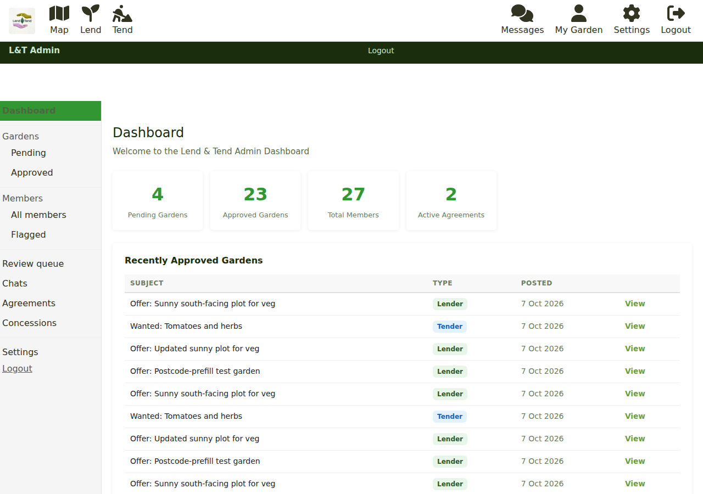

# Getting started as an admin

## Who can get in

The admin area checks your account's **system role**. Only **Admin** and **Support** can
use it; everyone else sees "You need admin or support role to access this area", and
visitors who are not signed in are asked to sign in.

Roles are set on the account itself (the `systemrole` on the user), not per community as
in Freegle. There is no self-service way to become an admin: an existing admin, or someone
with database access, grants the role. On a development stack the migrations seed a demo
admin (`admin@test.com`); production has no demo accounts.

## Signing in

There is no separate admin login. Sign in to the site as any member does - ask for a
sign-in link, open it from your email - then go to `/admin`. The **L&T Admin** bar across
the top and the menu down the left tell you that you are in the admin area; **Logout**
is in both.

## The dashboard

The dashboard (`/admin`) shows four counts and a table:

- **Pending Gardens** - listings waiting for approval. Normally zero, because listings go
  live automatically (see [moderating listings](moderating-listings.md)).
- **Approved Gardens** - live listings, lenders and tenders together.
- **Total Members** - everyone who has joined the site.
- **Active Agreements** - live listings that have an agreement proposed or confirmed.
- **Recently Approved Gardens** - the ten newest live listings, each with a **View** link
  to the public listing page.

## The menu

- **Dashboard**
- **Gardens**: **Pending** and **Approved**
- **Members**: **All members** and **Flagged**
- **Review queue** - chat messages held by the word filter or reported by members
- **Chats** - conversations between members and the team
- **Agreements** - every proposed or sealed agreement
- **Concessions** - members on a free membership
- **Settings** - what this deployment is pointed at

Each is covered in the next guides.

## Next steps

- The daily work: [Moderating listings](moderating-listings.md).
- Looking after people: [Managing members](managing-members.md).
- Everything else: [Running the service](running-the-service.md).
