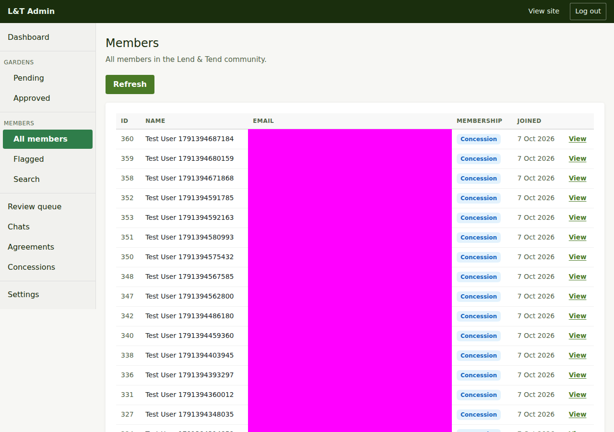
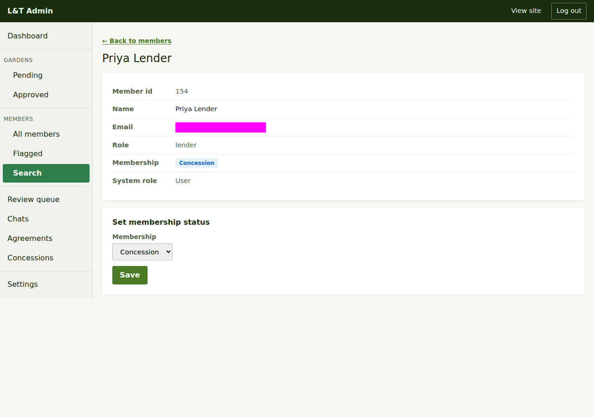
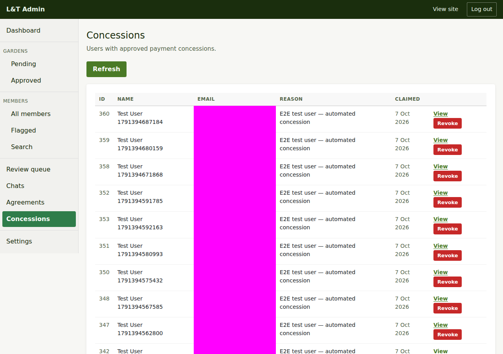

# Managing members

## The members list

**Members > All members** (`/admin/members`) lists everyone who has joined: id, name,
email, a **Membership** badge (**Paid**, **Concession** or **Not joined**) and the date
they joined, with **Refresh** to reload. **View** opens the member's detail page.

## A member's detail page

The detail page (`/admin/users/<id>`) shows the member's id, name, email, the role they
chose (lender, tender or both), their **Membership** (Paid, Concession or Not joined),
and their system role.

### Setting membership status

Under **Set membership status** you can set a member to:

- **Not joined** - they have not paid and cannot message.
- **Paid** - as if they had paid the £12 fee.
- **Concession** - a free membership.

Click **Save**. Use this when a payment went through but did not register, when someone
paid another way (a cheque, a refund reversed), or to grant a concession on request. The
change is recorded as made by an admin, with the time.

Members cannot set their own payment status. The only things that can mark a member paid
are a confirmed Stripe payment, a concession claim, and this page. (That protection is
enforced by the API's `PROTECTED_SETTINGS_KEYS` setting; see
[running the service](running-the-service.md).)

## Concessions

**Concessions** (`/admin/concessions`) lists every member on a free membership, with the
reason they gave and the date it was **Claimed**, and a **View** link to their detail
page. A concession takes effect the moment a member claims it on the Join page; this page
is where you see them afterwards.

**Revoke** clears the member's membership: they go back to "not joined" and are asked to
pay the next time they try to message. Use it sparingly, and tell the member why.

## Finding one member

**Members > Search** (`/admin/users`) finds a member by name or email address. Type part
of either and press Enter (or the search button); each result shows the member's name,
email, membership status and role, with a **View** link to their detail page. The page asks for a search term first,
so it never lists everyone (use **All members** for that).

## Flagged members

**Members > Flagged** (`/admin/members/flagged`) lists members who have a chat message
sitting in the [review queue](moderating-listings.md#the-review-queue), whether because the
word filter held it or because another member reported it. It is a prompt to look, not a
verdict: approve or reject the message in the review queue, and the member drops off this
list.

There is no ban button in the admin area. If someone has to be removed, that is done on
the Freegle side of the system (the ModTools-based admin app, or by the technical team).

## Chats with the team

**Chats** (`/admin/chats`) lists conversations between members and the Lend & Tend team,
with the participants, the last message and its date, and a **View** link that opens the
conversation in the normal chat screen so you can reply. Reported member-to-member
messages are not here; they are in the review queue.

## Next steps

- Agreements, settings and the switches: [Running the service](running-the-service.md).
