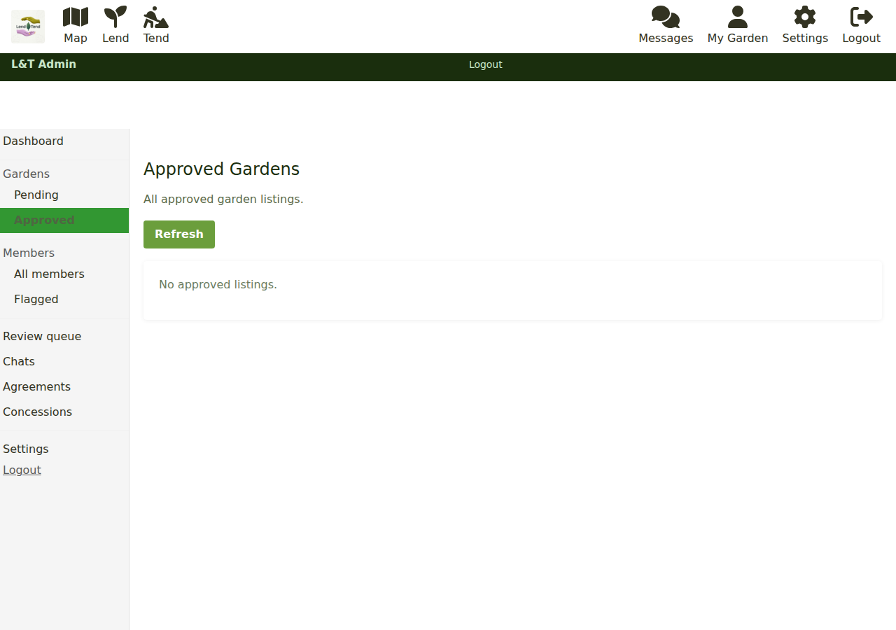
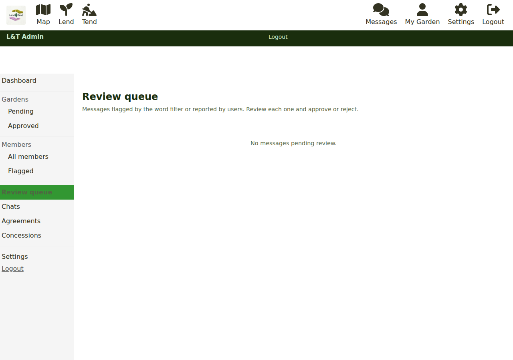

# Moderating listings

There are two queues: garden listings, and chat messages that have been held back. Most
days the first is empty and the second is short.

## Why listings go live without you

Lend & Tend does **not** pre-approve listings by default. Behind the scenes every listing
is a post in one world-wide group whose default posting status is "unmoderated", and new
members are made unmoderated as they join, so a garden is approved the moment it is
posted and appears on the map within a minute (the batch job `messages:update-spatial-index`
refreshes the map index every minute). The posting forms are written to match: with moderation off they submit straight
to the approved list.

Pre-approval can be switched on for the whole site with the `LAT_MODERATION_ENABLED`
deployment setting (see [running the service](running-the-service.md#switches-that-change-how-the-site-behaves)).
With it on, new listings are held as **Pending** until an admin approves them.

Whichever mode you are in, what the member sees after posting is the same: their listing
under **My Garden** and a note that it will appear on the map.

## Pending gardens

**Gardens > Pending** (`/admin/gardens/pending`) lists listings waiting for a decision:
id, subject, whether it is a **Lender** (a garden) or **Tender** (looking to tend), who
posted it and when. For each you can:

- **✓ Approve** - the listing goes live.
- **✗ Reject** - the listing is turned away.
- **View** - open the public listing page to read it in full.

**Refresh** reloads the list. With moderation off this page is normally empty.

## Approved gardens

**Gardens > Approved** (`/admin/gardens/approved`) is every live listing, in the same
layout, with a **View** link to each. Use it to find a listing someone has asked about, or
to check a lender's garden before dealing with a report. Editing a listing is done by its
owner; you can see the public listing but not change it from here.

## What to look for

- **Personal details in the description.** Addresses, postcodes and phone numbers have
  private fields of their own and should not be in the public text. If a member has typed
  them into the description, ask them (by chat) to move them.
- **Commercial use.** The site is for sharing, not letting. Anything that reads like a
  rental or a business advert is not for Lend & Tend.
- **Safety.** Anything that suggests a risk to a tender (dangerous access, hazardous
  materials) is worth a friendly message to the lender before it causes a problem.

## The review queue

**Review queue** (`/admin/moderation`) holds chat messages that did not go straight
through: either the **word filter** caught something (the reason is shown as a badge on
the message), or a member clicked **Report** on it. The message, who sent it, when, and
the listing it is about are shown.

For each you can:

- **✓ Approve** - the message is delivered to the recipient.
- **✗ Reject** - the message is not delivered.
- **⏸ Hold** - keep it in the queue while you look into it.

Members whose messages are in this queue also appear under
**Members > Flagged** (see [managing members](managing-members.md)).

A held message is invisible to its recipient until you act, so keep an eye on this queue:
a genuine message stuck here is a conversation that has gone cold for no reason.

The words the filter looks for are Freegle's standard "concern keywords" list, maintained
in the database rather than in the admin area.

## Next steps

- Reports usually lead to a person: [Managing members](managing-members.md).
