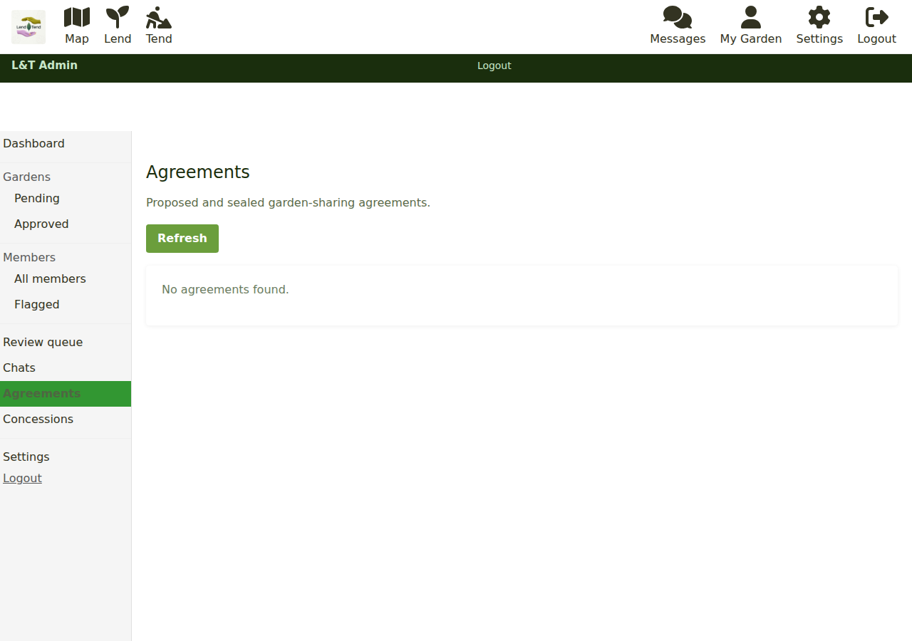
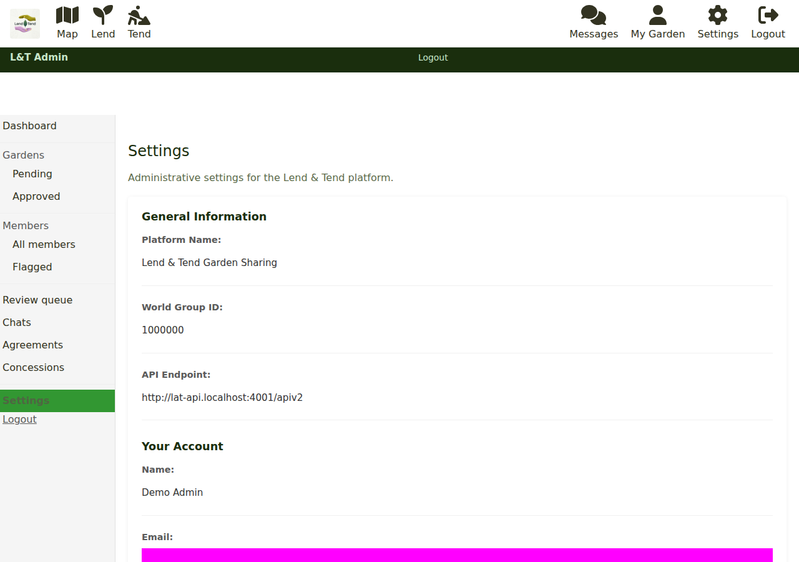

# Running the service

Beyond the daily queues, this page covers the rest of the admin area, the deployment
switches that change how the site behaves, and where the technical material lives.

## Agreements

**Agreements** (`/admin/agreements`) lists every garden-sharing agreement across the site:
the listing it belongs to, whether it is **Proposed** (sent, not yet accepted) or
**Sealed** (accepted by both), and the dates. The listing id links to the public listing
and **View** opens the agreement itself, read-only for you.

Use it to answer "how many active arrangements do we have?" and to find the agreement
behind a mediation request. Members ask for mediation through the **Not working** option
on a check-in, which points them at the contact form with the arrangement id filled in.

## Settings

**Settings** (`/admin/settings`) is read-only. It shows what this deployment is pointed
at - the platform name, the **World Group ID** (the single Freegle group that holds every
listing) and the **API endpoint** - and which account you are signed in as. If the counts
on the dashboard look wrong, the first thing to check is that the world group id here
matches the group the listings are actually in.

## The second admin app

There is also a separate, ModTools-based admin app (`iznik-nuxt3/modtools-lat`, the
`lat-admin` container) with its own **Dashboard**, **Users**, **Listings** and
**Concession requests** pages. It uses the same Admin and Support roles. The pages at
`/admin` on the main site are the day-to-day tools; the separate app is where the
Freegle-side tools will live as they are needed. Both read and write the same database.

## Switches that change how the site behaves

These are deployment settings, set in `docker-compose.lat.yml` (and the Fly and Caddy
files under `deploy/`), not in the admin area. Changing one is a deployment, done by the
technical team. They are listed here so you know what is possible and what the current
behaviour depends on.

| Setting | Where | What it does |
|---------|-------|--------------|
| `LAT_MODERATION_ENABLED` | frontend | **Off** (default): listings go live the moment they are posted. **On**: new listings are held as Pending for an admin to approve. See [moderating listings](moderating-listings.md). |
| `PROTECTED_SETTINGS_KEYS=lat_payment` | API | Stops members changing their own payment status. Only the server (a confirmed Stripe payment, a concession claim) and an admin on the member detail page can set it. |
| `STRIPE_SECRET_KEY`, `STRIPE_WEBHOOK_SECRET`, `STRIPE_SUCCESS_URL`, `STRIPE_CANCEL_URL` | frontend server | The Stripe account and the pages members return to after paying. A **test** key shows a "Test mode" banner on the Join page and takes no real money. |
| `LAT_ALLOW_FAKE_PAYMENT` | frontend | Development only: adds a "Pretend to pay" button to the Join page. Never on in production. |
| `JWT_SECRET` | frontend server and API | Must be the same value on both, or the server cannot act on a member's behalf (payments would not be recorded). |
| `LAT_WORLD_GROUPID` | frontend and admin app | The group every listing lives in. |

## Payments

Payments go through Stripe Checkout. The member pays on Stripe's page, Stripe tells our
server (a webhook), and the server records the payment on the member's account. The
member's browser also confirms on return, so a slow webhook does not leave them locked out.
Lend & Tend never sees card details.

Refunds are made in the Stripe dashboard, not in the admin area. After refunding, set the
member's payment status back to **Not joined** on their
[detail page](managing-members.md#setting-payment-status) if that is what was agreed.

The hand-off guide for whoever holds the Stripe account - which keys to create and where
to put them - is kept with the deployment notes.

## Email

The site sends mail through the batch worker (the same Laravel jobs Freegle uses, plus
Lend & Tend's own):

| Job | When | What |
|-----|------|------|
| sign-in links, chat notifications | as they happen | Freegle's standard mail, with Lend & Tend wording. |
| `lat:send-welcome` | on request | A welcome email to a given member, or a trial send to an address. It is not sent automatically on sign-up. |
| `lat:send-activity-alerts` | daily, 08:00 | New listings within each member's travel radius, respecting their instant / daily / weekly choice. |
| `lat:send-checkin-reminders` | daily, 09:00 | The two-week, one-month, three-month and six-month check-in prompts to both parties of a confirmed agreement. |
| `lat:send-post-agreement-prompts` | daily, 09:30 | Just after an agreement: asks the tender if they are still looking and the lender if they have another garden. |
| `lat:send-match-news` | hourly | Tells nearby members a garden has been matched. |
| `lat:send-monthly-checkin` | 1st of the month, 10:00 | The "still interested?" nudge to unmatched members who have it turned on. |

Locally all of this lands in Mailpit. In production it goes out through the configured
mail provider; see the deployment notes for which.

Members who use the **Contact us** form generate an email to the team's inbox with a
reply-to set to the member, so you can answer from your mail client.

## Where the technical material lives

- The repository's `CLAUDE.md` is the authoritative description of how the Lend & Tend
  layer fits on Freegle, what must never be changed upstream, and how the stack is
  deployed (Docker Compose on a Katapult VM behind Caddy).
- The [Freegle docs](https://github.com/Freegle/Iznik/tree/master/docs) cover the
  software itself: architecture, APIs, testing, operations and runbooks.
- Lend & Tend's own tests are under `iznik-nuxt3/tests/e2e/lat` and
  `iznik-nuxt3/tests/unit/lat`.
- Error monitoring is Sentry (Lend & Tend's own project), and it is only switched on in a
  member's browser once they accept the cookie banner.

## Next steps

- Back to the daily work: [Moderating listings](moderating-listings.md) and
  [Managing members](managing-members.md).
