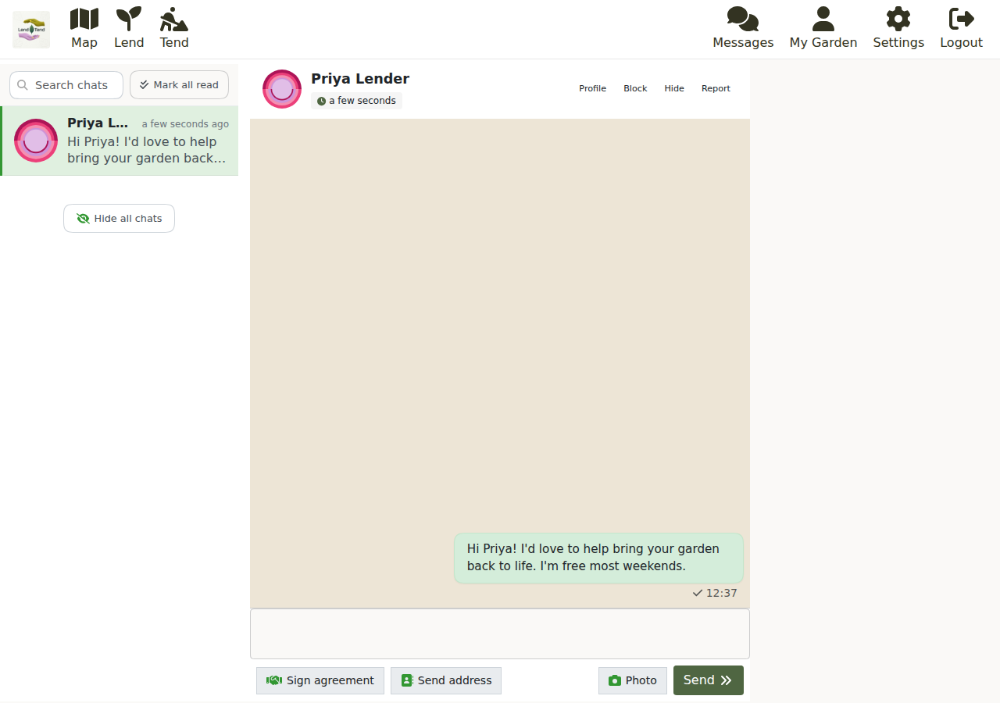
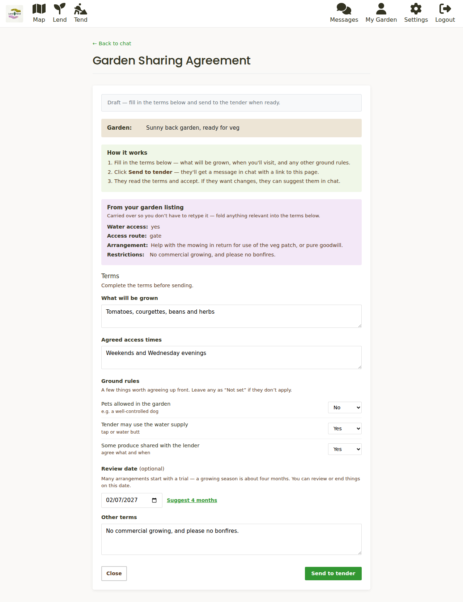
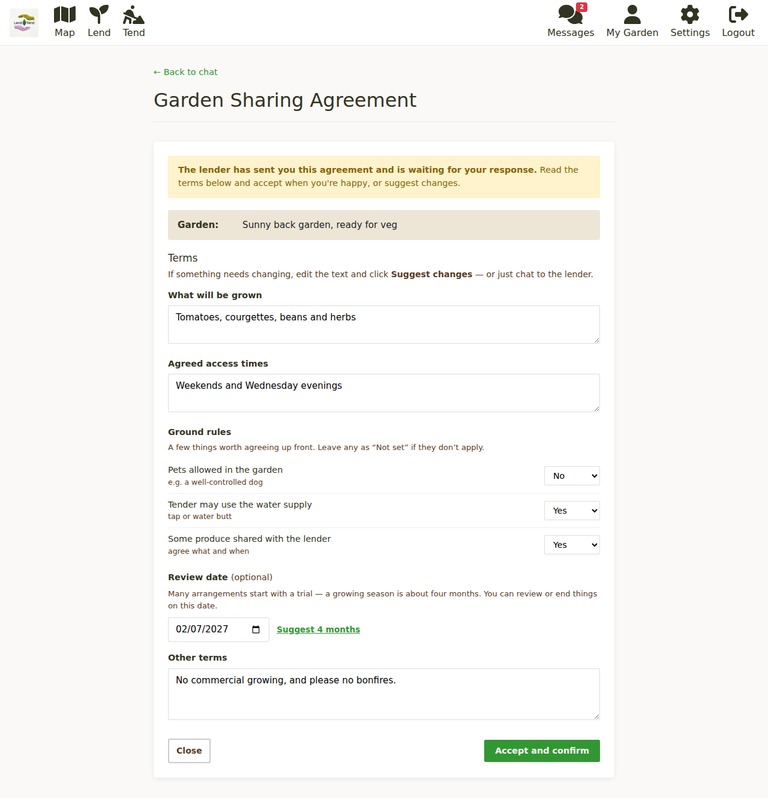
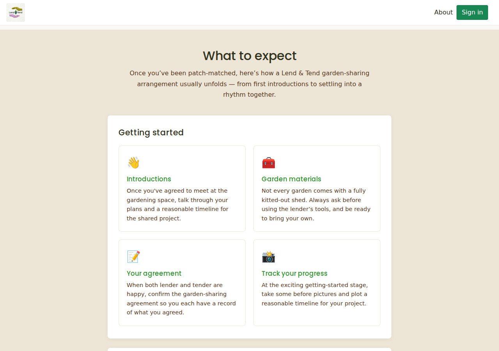
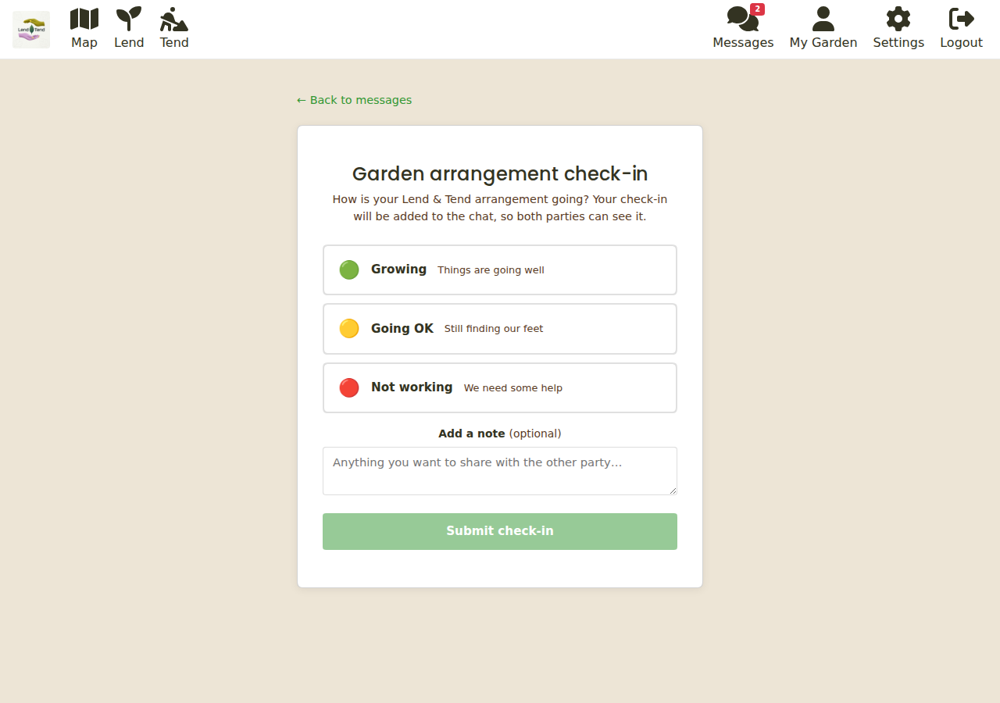

# Agreements and check-ins

Everything after the first message happens in three places: the **chat**, the **Garden
Sharing Agreement**, and the occasional **check-in**. This guide walks through all three.

## The chat

**Messages** (`/chats`) lists your conversations on the left and the open one on the
right. Each conversation is private between the two of you.

- Type in the box at the bottom and click **Send**. You can attach a **photo**.
- Messages are checked for suspicious content before they are delivered, so a new message
  can take a minute to appear for the other person. Both of you get an email when there is
  something new to read.
- Messages are stored on the site (they are not end-to-end encrypted) so that the team can
  look at a conversation if it is reported.

### Sharing your address

Your full address is never on your listing. When you are ready for the other person to
have it, click **Send address** under the message box. It lists your gardens that have an
address saved and posts the one you choose into this conversation only. Tenders can share
an address the same way if they have a listing with one.

### Block and report

At the top of a conversation you can **Block** the other member, which hides the
conversation and stops their messages reaching you (choose **Unblock** to undo it), and
**Report** a message to the team. Reporting puts the conversation in front of the Lend &
Tend team for review.

## The Garden Sharing Agreement

When you have talked things through, put it in writing. Either of you can start: click
**Sign agreement** under the message box. The agreement is attached to the garden listing
and to the two of you.

If the garden was posted less than a minute ago, the button tells you the listing is not
findable yet and asks you to try again shortly, rather than doing nothing.

1. **Fill in the terms.** What will be grown, the agreed access times (when the tender
   will visit), and any other terms in your own words. Details from the garden listing are
   carried over so you do not have to retype them.
2. **Settle a few ground rules up front**, each a simple Yes, No or Not set: whether pets
   are allowed in the garden, whether the tender may use the water supply, and whether some
   produce will be shared with the lender.
3. **Set a review date.** Many arrangements start with a trial; **Suggest 4 months** fills
   in a growing season. It is a date to talk, not a deadline.
4. Click **Send to tender** (or to the lender). The agreement is now **proposed**.

The other person gets a card in the chat. They open it, read the terms, and either click
**Accept and confirm**, or edit the text and click **Suggest changes** to send it back (or
simply talk it over in the chat). Once accepted the
agreement is **confirmed**: both of you see it, the garden shows as matched under **My
Garden**, and it joins the **Active** filter on the map. Nearby members may get a short
"good news" email that a garden near them has been matched.

Either of you can **Withdraw agreement** at any point. If things are not working out, say
so in the chat first; the team can help mediate (see check-ins below).

### The ground rules

The agreement is a plain-English summary of our garden-sharing template. The full version
is at **Ground rules** (`/ground-rules`): the main points, the conditions of use you should
agree before you start, and our safeguarding position. It is a guide, not legal advice. Any
incident involving harm, fraud, theft or property damage must be reported to the
appropriate authorities, and you can always contact the team.

## What to expect

**What to expect** (`/what-to-expect`) sets out how a first season usually goes, from
introductions to settling into a rhythm, with a realistic timeline. Every garden is
different; the important thing is to keep in touch.

## Check-ins

A growing season is long, and arrangements drift when nobody says anything. So Lend & Tend
asks each of you how it is going at **two weeks, one month, three months and six months**
after the agreement is confirmed, by email, with a link to the check-in page
(`/checkin/<id>`). You can also open it from the agreement at any time.

Pick one of three:

- **Growing** - things are going well.
- **Going OK** - still finding our feet.
- **Not working** - we need some help.

Add a note if you like and click **Submit check-in**. Your answer is posted into the chat
so both of you can see it. If you choose **Not working**, the page offers to put you in
touch with the team to mediate.

## Next steps

- Matched and wondering about other gardens or alerts? See
  [Lending your garden](lending-your-garden.md#when-your-garden-is-matched) and
  [Tending a garden](tending-a-garden.md#once-you-are-matched).
- Change what we email you in [Your account](your-account.md).
