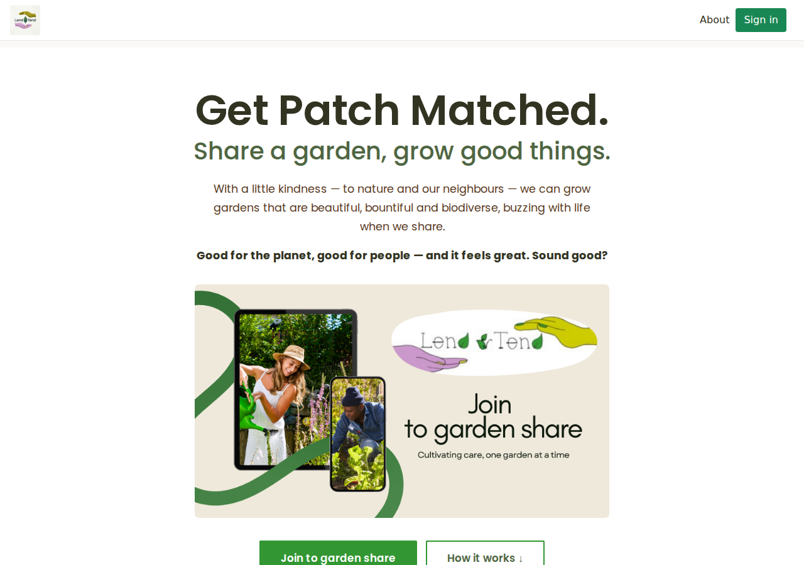
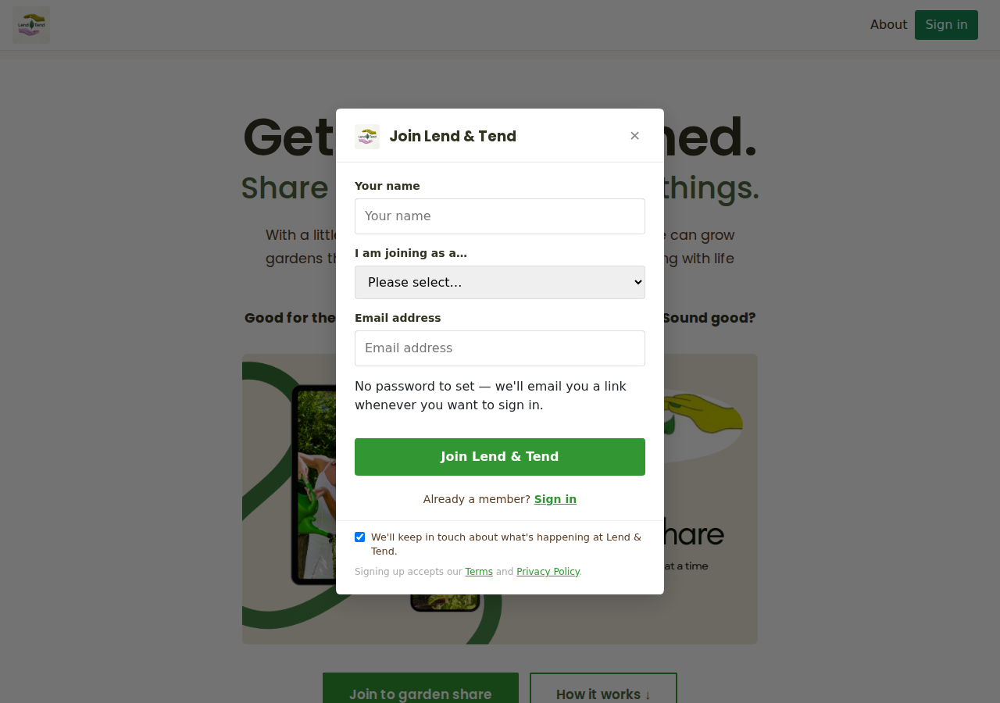
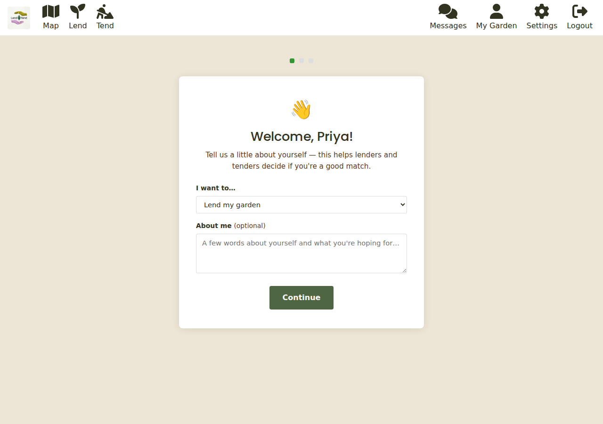
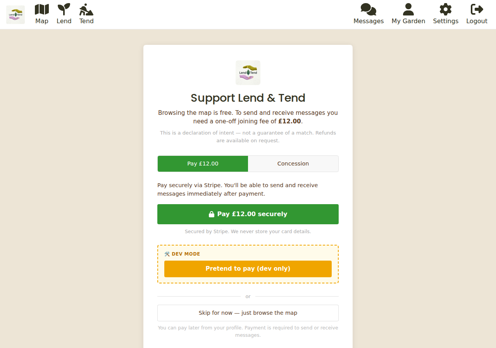
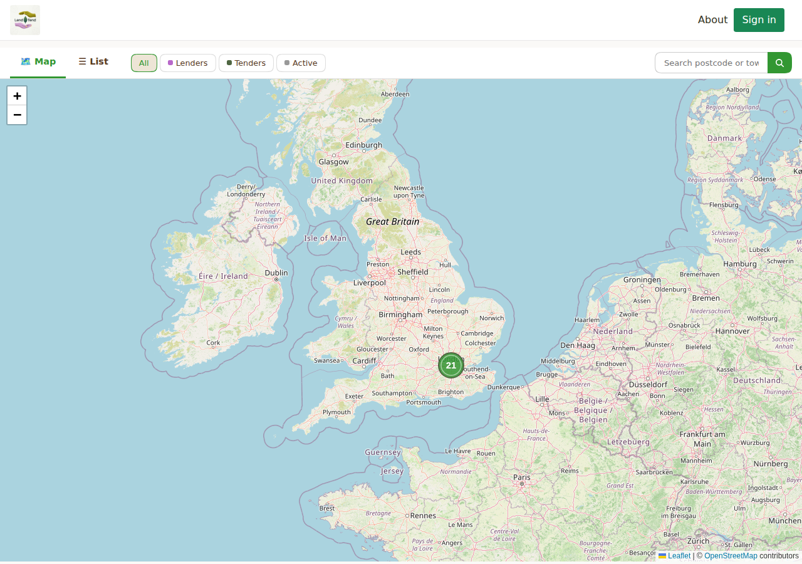

# Getting started

This guide gets you from never having used Lend & Tend to browsing the map, signed in,
and ready to share a garden or find one.

## Creating an account

You can browse the map without an account. You need one to post a listing, and you need
to join (see below) to send and receive messages.

1. Click **Sign in** at the top of any page, then **Join Lend & Tend**.
2. Enter your name, choose whether you are joining as a **lender**, a **tender** or
   **both**, and enter your email address.
3. Untick the marketing box if you would rather not hear from us beyond the essentials,
   then click **Join Lend & Tend**.

That is it: there is **no password to choose**. You are signed in straight away.

### Signing in later

Lend & Tend never asks for a password. Whenever you want to sign in:

1. Click **Sign in**, enter your email address and click **Email me a sign-in link**.
2. Open the email and click the link. It signs you in on the device where you opened it.

The box says "Check your email" while you wait. If nothing arrives within a few minutes,
check your spam folder, then use **use a different email** to try again. The address must
be the one you joined with.

Signing in on another device is the same: ask for a link there, and open it there.

## Telling us about yourself

Right after you join we ask three quick things, each of which you can come back to later
in [your account](your-account.md):

1. **About you.** Confirm whether you want to lend, tend or both, and add a line or two
   about yourself. Lenders and tenders use this to decide if you are a good match.
2. **Create your listing.** Jump straight to
   [listing your garden](lending-your-garden.md) or
   [saying what you are looking for](tending-a-garden.md), or **Skip for now**.
3. **Join.** Browsing is free. To send and receive messages you pay the one-off joining
   fee (next section), or go straight to the map.

## The joining fee

Sending and receiving messages needs a **one-off £12 joining fee**. It is not a
subscription and there is nothing further to pay. It is a declaration of intent rather
than a guarantee of a match, and refunds are available on request.

On the **Join** page (`/join`) you can:

- **Pay £12 securely.** Payment is handled by Stripe. Lend & Tend never sees or stores your
  card details. Once Stripe confirms the payment you land on a welcome page and can message
  straight away. If the confirmation is slow, the page offers **Check again**.
- **Apply for a concession.** Membership is free if you receive Universal Credit or
  Pension Credit, or are in financial difficulty. Choose the **Concession** tab, tell us
  briefly why you are applying, and click **Apply for concession**. This is honour-based:
  your membership is active immediately, and the team may get in touch.
- **Skip for now** and just browse the map. You can pay later from your account settings,
  and the site reminds you whenever you try to message someone.

You will see "You're all set" on this page once you have joined.

## Finding your way around

Once signed in, the menu across the top gives you:

- **Map** - every garden and every "looking to tend" post, on a map or as a list.
- **Lend** - list a garden you have to share.
- **Tend** - post what you are looking for.
- **Messages** - your private conversations.
- **My Garden** - the listings you have posted and their status.
- **Settings** - your profile, alerts and membership.

The footer links to **What to expect**, the **Ground rules**, **Help**, **Terms** and
**Privacy**.

## The map

The map (`/map`) is where everyone meets. Switch between **Map** and **List**, and
filter to **Lenders**, **Tenders**, or **Active** (gardens with an agreement already in
place). Type a postcode or town into the search box to jump to an area.

Pins are deliberately **blurred to about a kilometre**, so nobody can work out where a
garden is from the map alone. Click a pin to see a summary and **View listing** for the
full post.

## Next steps

- Have a garden to share? See [Lending your garden](lending-your-garden.md).
- Looking for somewhere to grow? See [Tending a garden](tending-a-garden.md).
