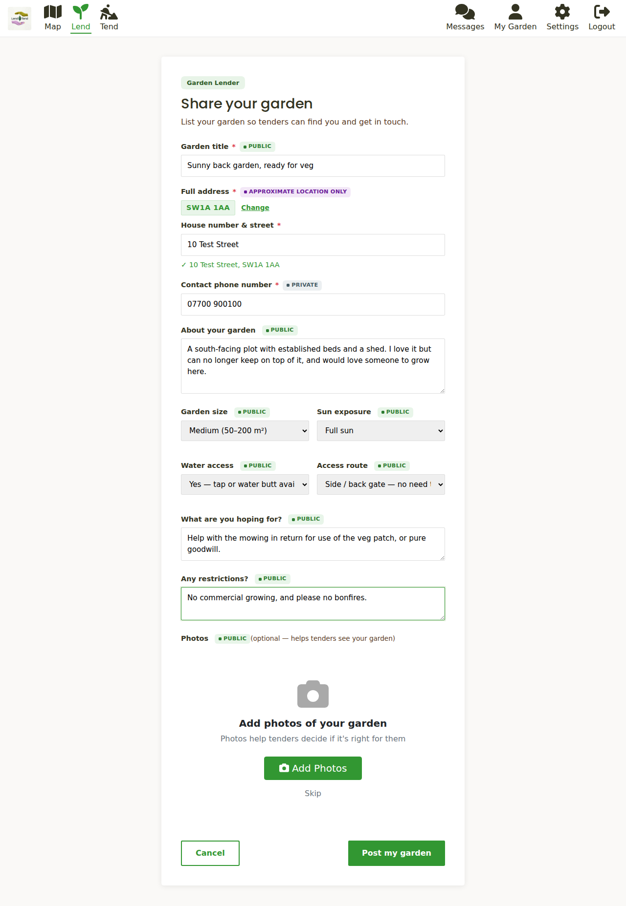
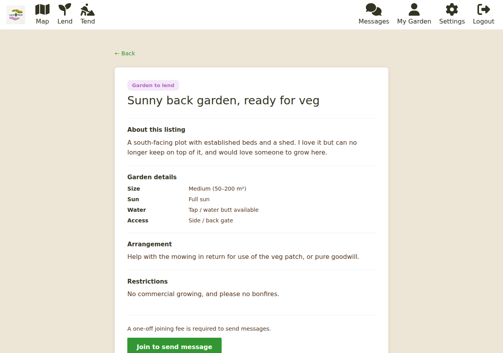
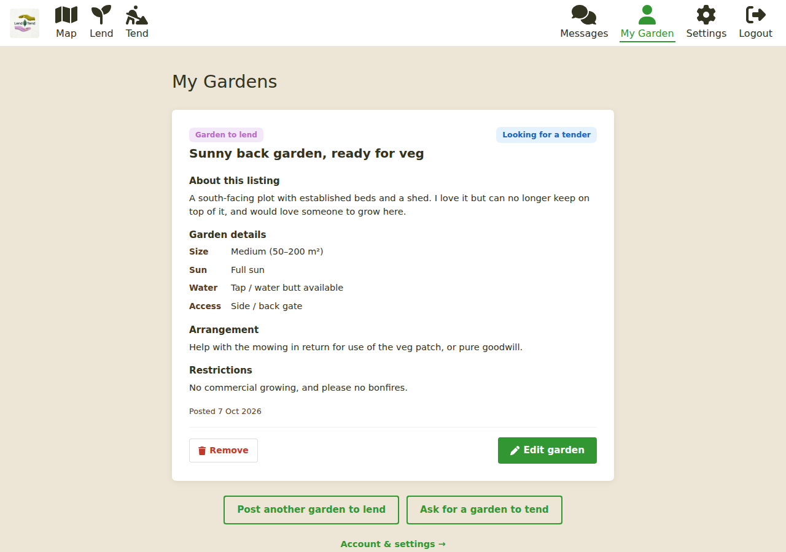

# Lending your garden

Listing a garden takes a few minutes. You describe it, say roughly where it is, add a
photo or two, and it appears on the map for tenders near you.

## Posting your garden

1. Click **Lend** (`/lend`). If you are not signed in you will be asked to sign in first.
2. **Give it a title.** Something like "Sunny south-facing plot, great for vegetables".
3. **Enter your full address.** Type your postcode and click **Find**, then pick your
   property from the list (or type the address if it is not listed). The map only ever
   shows a blurred spot about a kilometre across; the full address is kept private.
4. **Enter a contact phone number.** This is private too. It is never shown on the
   listing.
5. **Describe the garden** - soil, access, how much there is to do, anything a tender
   should know. The dropdowns cover **size**, **sun**, **water access** (is there a tap or
   water butt?) and **access route** (a side gate, or through the house).
6. **Say what you are hoping for.** Help with the mowing in return for the veg patch?
   Pure goodwill? Be honest: this is what tenders will respond to.
7. **Add any restrictions** - no commercial growing, no bonfires, no dogs, and so on.
8. **Add photos** (up to five). A photo is the single most effective thing you can do; it
   helps tenders decide whether the garden is right for them.
9. Click **Post my garden**.

You are taken to **My Garden**, where your listing now appears. It shows on the map, and
to other members, within a minute or so: the index behind the map is refreshed every
minute.

If you have not yet paid the joining fee the page says so at the top, and the button shows
the price. You can still fill the form in; you are asked to join when you post.

### What is public and what is private

Every field on the form carries a coloured hint:

- **Public** (green) - shown on your listing for anyone to read: title, description,
  size, sun, water, access route, what you are hoping for, restrictions and photos.
- **Approximate** (lilac) - your location. Only a blurred position appears on the map.
- **Private** (grey) - your full address, postcode and phone number. These are stored
  with your account, not on the listing, and nobody else can see them until you choose
  to share them.

When you are ready to share your address with a tender, use **Send address** in the chat.
It lists your gardens and posts the address of the one you pick into that conversation
only. See [Agreements and check-ins](agreements-and-check-ins.md).

## Your listing page

Everyone sees your garden at `/garden/<id>`: the title, the blurred location name, your
photos (click one to see it large), the description and the details you chose. Tenders
who have joined see a **Send message** button; anyone who has not yet joined is offered
**Join to send message**.

On your own listing you see **Edit listing** instead, and **View agreement** once an
agreement exists.

## My Garden

**My Garden** (`/profile`) lists everything you have posted, each with its status:

- **Looking for a tender** - live, waiting for interest.
- **Agreement proposed** - an agreement has been drafted and sent but not yet accepted.
- **Agreement confirmed** - you are matched. The status links to the agreement.

From here you can **Edit garden** or **Remove** a listing, post another garden, or ask for
a garden to tend. Editing (`/garden/<id>/edit`) shows the same form with your answers
filled in. The address is shown as "Current: ..." and you re-enter it only if it needs to
change. Save with **Save changes**.

## When your garden is matched

Once an agreement is confirmed, your listing shows as matched and appears under the
**Active** filter on the map. A day or so later we email to ask **Have you another garden
to share?** (`/share-another`). Say yes and you go straight to the listing form; say no and
we simply note it and carry on with the usual check-ins.

## Tips for a good listing

- Lead with a photo of the growing space itself, not the house.
- Say how much time the garden needs. "Needs a couple of hours a week" sets expectations.
- Mention what is already there - beds, a shed, a water butt, established plants.
- Keep your address and phone number out of the description. The private fields exist for
  that, and sharing happens in the chat when you are ready.

## Next steps

- Someone has messaged you? See [Agreements and check-ins](agreements-and-check-ins.md).
- Set how far you are willing to travel and when we email you in
  [Your account](your-account.md).
