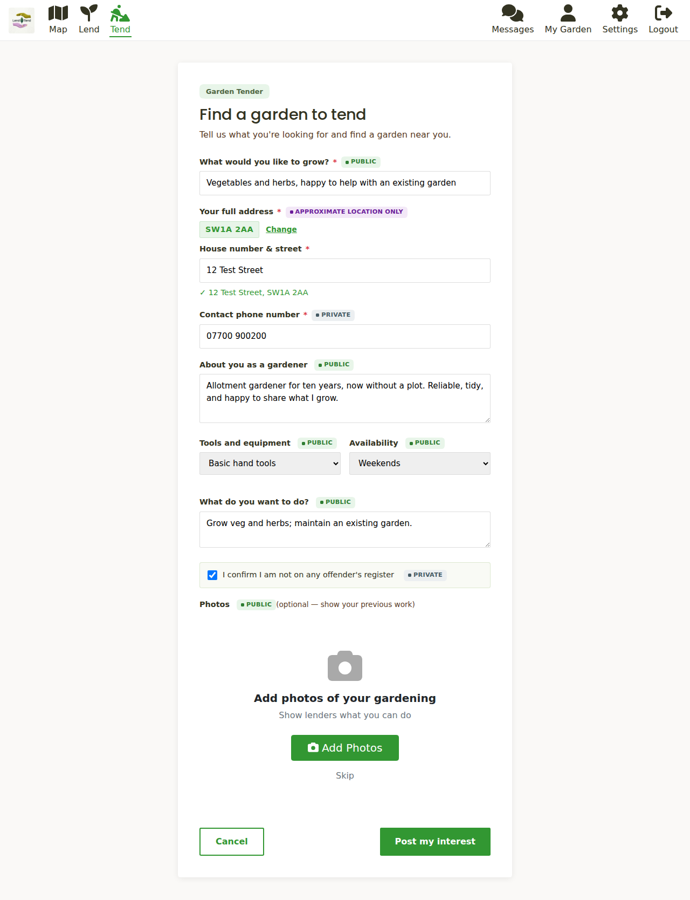

# Tending a garden

There are two ways to find a garden: browse the map and message a lender directly, or
post what you are looking for so lenders can find you. Most tenders do both.

## Posting what you are looking for

1. Click **Tend** (`/tend`).
2. **Say what you would like to grow** - vegetables and herbs, flowers, or help with an
   existing garden.
3. **Enter your full address** and a **contact phone number**. As with a garden listing,
   only a blurred position goes on the map and the phone number is private.
4. **Tell lenders about you as a gardener** - your experience, what you love growing.
   Choose what **tools** you have (basic hand tools, a full set, or none), and your
   **availability** (weekends, weekdays, evenings or flexible).
5. **Say what you want to do** - grow veg, maintain an existing garden, flowers only,
   and so on.
6. Tick the declaration confirming that you are not on any offender's register. This is
   private and is part of our safeguarding.
7. Click **Post my interest**.

Your post appears on the map with a green **Tenders** pin, and under **My Garden**.

## Browsing the map

The map (`/map`) shows every lender (lilac pins) and every tender (green pins). Use the
filters to show just **Lenders**, search for a postcode or town, or switch to the
**List** view to read posts as cards.

Click a pin, then **View listing**, to read the full post: the description, size, sun,
water, access, what the lender is hoping for and any restrictions.

### Getting in touch

On a listing, click **Send message**. This opens a private chat with the lender. Say a
little about yourself and what you would do with the space; lenders are choosing a person
as much as a gardener.

If you have not yet paid the joining fee the button reads **Join to send message** and
takes you to the [Join page](getting-started.md#the-joining-fee) first.

The chat, the agreement and everything after are covered in
[Agreements and check-ins](agreements-and-check-ins.md).

## Hearing about new gardens

You do not have to keep checking the map. In [your account](your-account.md) you can turn
on **local activity alerts**: we email you when a new garden appears within your **travel
radius**, either as it happens, as a daily digest, or weekly.

While you are unmatched we also send an occasional **"still interested?"** reminder with
recent listings near you. You can turn that off in your account too.

## Once you are matched

After an agreement is confirmed we email to ask **Still looking for a garden?**
(`/still-looking`). Choose **keep them coming** to carry on receiving alerts, or tell us
you are sorted and alerts pause. Either can be changed later in your account.

## Staying safe

- Meet at the garden in daylight the first time, and tell someone where you are going.
- Keep the conversation in Lend & Tend messages until you are both comfortable.
- You can **Report** a listing or a message (offensive content, spam, personal contact
  details, something that looks fake, or anything else) and **Block** a member from the
  top of a chat. Reports go to the Lend & Tend team.
- All members must be 18 or over. The [ground rules](agreements-and-check-ins.md#the-ground-rules)
  cover safeguarding in more detail.

## Next steps

- Found a garden? See [Agreements and check-ins](agreements-and-check-ins.md).
- Set your travel radius and alerts in [Your account](your-account.md).
