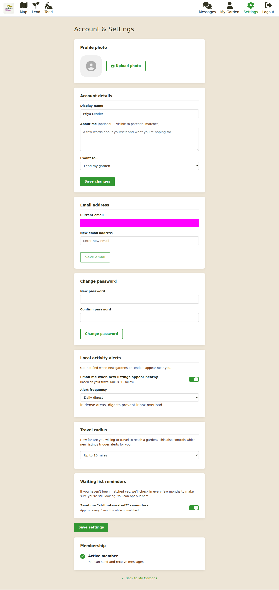

# Your account

Everything about how Lend & Tend works for you lives on the **Settings** page
(`/settings`). **My Garden** (`/profile`) is different: that is your listings.

## Your profile

- **Profile photo** - upload one if you like. People you message see it.
- **Display name** and **About me** - a few words about yourself and what you are hoping
  for. Potential matches read this, so it is worth filling in.
- **I want to...** - lend my garden, tend someone's garden, or both. This is what you
  chose when you joined; change it here any time.

Click **Save changes** after editing.

## Email address

Your current address is shown. To change it, type a new one and click **Save email**.
Because sign-in links go to this address, make sure you can read mail there before you
switch.

There is also a **Change password** section. You do not need a password to use Lend &
Tend - signing in is always by emailed link - so you can leave it alone.

## Local activity alerts

Turn on **Email me when new listings appear nearby** to hear about new gardens (or new
tenders) within your travel radius. Choose how often:

- **As it happens** - one email per new listing.
- **Daily digest**.
- **Weekly digest** (sent on Mondays).

Alerts are sent each morning, and you are never told about the same listing twice.

## Travel radius

How far you are prepared to travel, from **1** to **50 miles**. It drives the activity
alerts above and the "still interested?" reminders below.

## Waiting list reminders

While you are unmatched, Lend & Tend sends an occasional **"still interested?"** email
with recent listings near you. Turn it off here if you would rather not get it. When you
are matched the reminders stop and we ask instead whether you are
[still looking](tending-a-garden.md#once-you-are-matched) or have
[another garden to share](lending-your-garden.md#when-your-garden-is-matched).

Alerts, travel radius and reminders are saved together: click **Save settings** under
them.

## Membership

This section shows whether you are an **Active member** (you can send and receive
messages) or **Not yet joined**, with a **Join now** link to the
[Join page](getting-started.md#the-joining-fee) if you have not paid or claimed a
concession.

## Emails you may get from us

- **Sign-in links**, whenever you ask for one.
- **New message** notifications from your chats.
- **Activity alerts** and **"still interested?"** reminders, as set above.
- **Check-in reminders** at two weeks, one month, three months and six months after an
  agreement is confirmed, and the one-off **still looking?** / **another garden?** questions
  just after.
- **Match news** when a garden near you is matched.

## Cookies and privacy

Lend & Tend uses only the cookies it needs to keep you signed in, plus optional error
reporting that is off until you say yes in the cookie banner. **Accept** and **Reject**
carry equal weight; neither is hidden. The full policy is at `/privacy` and the terms of
service at `/terms`.

## Getting help

- **Help** (`/help`) answers the common questions: the fee, concessions, privacy of your
  address and messages, blocking and reporting, and what happens if a match does not work
  out.
- **Contact us** (`/contact`) is a short form: your name, email, what it is about (signing
  up, payment, a specific person or chat, the agreement, your account, a technical problem
  or something else) and your message. The team aims to reply within one working day.
- Or email `hello@lendandtend.com` directly.

## Leaving

If you want to close your account, use the contact form and ask. The team will deal with
it and confirm by email.

## Next steps

- New here? Start with [Getting started](getting-started.md).
- The team who run the site have their own guide under [../admins/](../admins/README.md).
